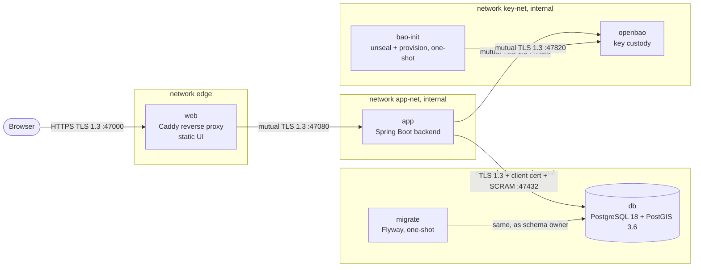

# 1. System overview

*Copyright (c) 2026 FLYT. Author: Pythagore.*

## Purpose

SNIGF/NILGS (Système National Intégré de Gestion Foncière / National Integrated Land
Governance System) manages land parcels, applications, reviews, decisions and payments
for Cameroon. Slice 1 delivers:

- staff login with strong authentication;
- role assignment;
- parcel creation from GeoJSON;
- a map view;
- a verifiable audit trail.

## Containers



| Service | Image | Role | Lifetime | Networks | User |
| --- | --- | --- | --- | --- | --- |
| `db` | `postgis/postgis:18-3.6` (pinned by digest) | Data, spatial validation, audit chain trigger | long-running | data-net | postgres (drops from root at start) |
| `migrate` | `flyway/flyway:12.4.0-alpine` | Applies `backend/src/main/resources/db/migration` as `snigf_migrator` | exits when done | data-net | 10003 |
| `openbao` | `snigf-openbao:local` (built from pinned OpenBao 2.7.1) | Holds every long-term key; signs, wraps, HMACs | long-running | key-net | 100 |
| `bao-init` | `snigf-openbao-init:local` | Initialises, unseals, provisions keys, policy and login; revokes its root token | exits when done | key-net | openbao |
| `app` | `snigf-backend:local` (`backend/Dockerfile`) | REST API, business rules, audit, scheduling | long-running | app-net, data-net, key-net | 10001 |
| `web` | `snigf-web:local` (`infra/proxy/Dockerfile`) | TLS termination, security headers, static UI, `/api` proxy | long-running | edge, app-net | 10002 |
| `dbtest` | built from `infra/db/test.Dockerfile` | pgTAP suite and concurrent chain test in a throwaway server | profile `test` | none | postgres |
| `security-probe` | `snigf-probe:local` | Asserts every transport and key-custody guarantee against the running stack | profile `test` | app-net, data-net, key-net | probe |
| `segmentation-probe` | `snigf-probe:local` | Asserts what the proxy's network cannot reach | profile `test` | app-net | probe |

### Start order

Compose enforces it with `depends_on` conditions:

1. `db` starts, and is healthy once it answers `pg_isready`.
2. `migrate` runs and must exit with code 0.
3. `openbao` starts sealed. It is healthy only once initialised and unsealed.
4. `bao-init` runs: it initialises (first time), unseals and provisions. It must exit with
   code 0.
5. `app` starts. It is healthy once its readiness covers the database and key custody.
6. `web` starts once `app` is healthy.

## Networks

| Network | Internal | Members | Why |
| --- | --- | --- | --- |
| `edge` | no | web | The only network with a published port |
| `app-net` | yes | web, app | The proxy reaches the API and nothing else |
| `data-net` | yes | app, migrate, db | Only these talk to the database |
| `key-net` | yes | app, bao-init, openbao | Only these talk to OpenBao |

"Internal" means no route to the internet. A compromised proxy reaches neither the
database nor OpenBao; the segmentation probe proves it.

## Ports

Every port is a setting, from the 47xxx block ([ADR-015](../adr/015-non-default-ports.md)).

| Port | Setting | Service | Protocol | Reachable from |
| --- | --- | --- | --- | --- |
| 47000 | `SNIGF_HTTPS_PORT` | web | HTTPS, TLS 1.3 | host, `127.0.0.1` only |
| 47080 | `SNIGF_APP_PORT` | app | mutual TLS 1.3 | app-net |
| 47081 | `SNIGF_MANAGEMENT_PORT` | app (actuator) | HTTP | the app container's loopback only |
| 47432 | `SNIGF_DB_PORT` | db | TLS 1.3 + client certificate | data-net; host loopback with `compose.dev.yml` |
| 47820 | `SNIGF_BAO_PORT` | openbao | mutual TLS 1.3 | key-net; host loopback with `compose.dev.yml` |
| 47821 | `SNIGF_BAO_CLUSTER_PORT` | openbao (Raft) | TLS | key-net |
| 47173 / 47174 | `SNIGF_VITE_PORT` / `SNIGF_VITE_PREVIEW_PORT` | Vite dev server / preview | HTTPS | host, during frontend work |

## Volumes

| Volume | Mounted into | Holds | Deleting it means |
| --- | --- | --- | --- |
| `db-data` | db | the database | all data lost |
| `bao-data` | openbao | OpenBao storage (Raft, encrypted by its barrier key) | all keys lost: nothing encrypted or signed can be opened or verified |
| `bao-audit` | openbao | OpenBao's audit log | OpenBao's history of key use lost |
| `bao-keys` | bao-init | **development only**: the unseal shares, standing in for the custodians | OpenBao can never be unsealed again |
| `audit-checkpoints` | app only | signed audit checkpoints and their public keys | the off-database evidence is lost; the auditor's copies remain |

`docker compose down -v` deletes them all together, which is consistent. Never delete
`bao-keys` or `bao-data` alone.

## Repository layout

```text
backend/                     Spring Boot application (Java 25, Maven wrapper)
  src/main/java/org/snigf/mvp/
    shared/                  cross-cutting: configuration guard, web filters, security baseline, ids
    keys/                    key custody (OpenBao client, KeyService)
    audit/                   audit trail: published API + domain/ application/ infrastructure/
    identity/ parcel/ application/ conflict/ document/ review/ payment/ reporting/
                             business modules, filled slice by slice
  src/main/resources/        application*.yaml, db/migration (Flyway)
  src/test/java/             unit (*Test) and integration (*IT) tests
  src/test/sql/              pgTAP tests, helpers, pgbench script
frontend/                    React 19 + TypeScript + Vite
infra/
  db/                        roles script, pg_hba.conf, start wrapper, database test image
  openbao/                   OpenBao images, configuration template, provisioning, policy
  proxy/                     Caddyfile and proxy image
  probe/                     security and segmentation probes
  scripts/                   dev-setup.sh, dev-pki.sh, db-test.sh, verify-checkpoint.sh
  secrets/                   generated passwords, keys, certificates (git-ignored)
docs/
  technical/                 this manual
  adr/                       architecture decision records
  guides/                    per-feature how-to guides
  audit.md                   audit design and residual risk
compose.yml, compose.dev.yml Compose stack and development overlay
.env.example                 every setting, documented (copied to .env)
CHANGELOG.md                 every change
```

## Technology versions

| Component | Version | Decision |
| --- | --- | --- |
| Java | 25 LTS | [ADR-002](../adr/002-java-25-spring-boot-4-1.md) |
| Spring Boot / Spring Modulith | 4.1.1 / 2.1.1 | ADR-002, [ADR-001](../adr/001-modular-monolith.md) |
| PostgreSQL / PostGIS | 18 / 3.6 | [ADR-003](../adr/003-postgresql-postgis.md) |
| Flyway | 12.4.0 (the version Spring Boot manages) | [ADR-009](../adr/009-least-privilege-roles.md) |
| OpenBao | 2.7.1 | [ADR-018](../adr/018-openbao-key-management.md) |
| Caddy | 2.11.7 (pinned by digest in `infra/proxy/Dockerfile`) | [ADR-010](../adr/010-caddy-same-origin.md) |
| React / TypeScript / Vite | 19.3 / 6.0 / 8.3 | [ADR-012](../adr/012-openapi-codegen.md) |
| Node.js (frontend build) | 24 | |
